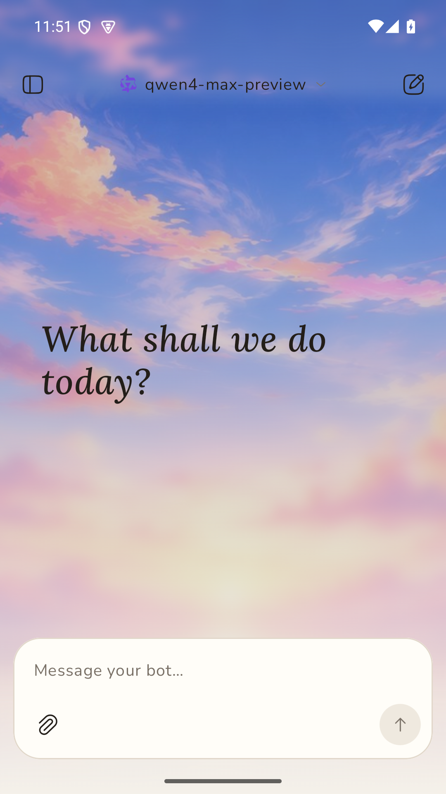
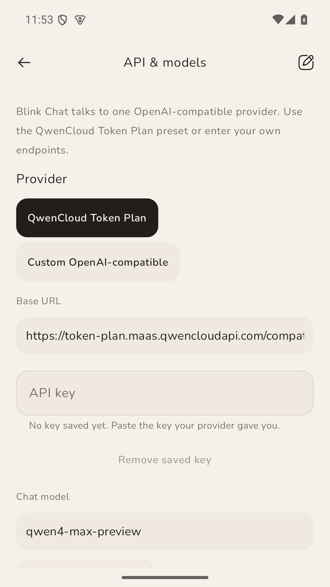

# Blink Chat 0.1.0 validation

Verified on 2026-11-11, using the Android 15 Compose QA emulator. This is a
development APK, separately installable as `me.waveio.blinkchat`; the original
Blink package remains `me.waveio.claudebot`.

## Delivered

- Blink's actual shared chat, composer, drawer, wallpaper, fonts, Markdown and
  media viewer, with standalone Profile, provider/model settings and Files.
- User-supplied HTTPS API endpoints and a Keystore-encrypted key. Endpoint/key
  updates commit together and block requests until their save finishes.
- Streamed text, inline photo understanding and image generation through
  QwenCloud Token Plan or a custom OpenAI-compatible provider.
- Selectable text/image model IDs, catalog discovery when supported, local
  conversations, reactions, per-chat drafts and history-preserving edit/retry
  branches. Image retries retain their request type.
- Bounded image, clock and private workspace tools, plus editable local files.
  Workspace traversal and symlink escapes are rejected. Editor/tool writes
  share a lock and atomic-file transaction.
- English/Ukrainian locale parity. Voice/scheduling controls are hidden until
  their standalone implementations exist.

## Verification

| Check | Result |
| --- | --- |
| Standalone debug APK | Built successfully |
| Standalone JVM tests | 37 passed |
| Android controller/storage/UI tests | 12 passed; opt-in live test skipped in the regular run |
| Opt-in QwenCloud smoke test | Passed separately with the real Android API client |
| Existing shared mobile unit tests | 362 passed |
| Original Blink debug APK | Built successfully; both packages installed together |
| Android lint | Passed; nonfatal version/style warnings remain |
| Host Python regression suite | 2,155 passed, 6 skipped; one external ASR failure described below |

The live smoke used `qwen3.8-flash` to identify a red circle from an inline PNG,
without putting its color or shape in the prompt. It then generated a valid
image with `qwen-image-3.0-pro` through the dedicated QwenCloud image endpoint.
The temporary private key fixture and saved test key were removed afterwards.
No real key is embedded in the APK or test sources.

Android tests cover tool round trips, Stop followed immediately by Send,
history-preserving edits, sent-attachment cleanup, draft restoration, dirty
workspace recovery, concurrent editor/tool writes, endpoint/key rollback and
requests blocked during a connection save. The actual Compose composer sends
text and creates an image, opens its media viewer, and navigates to settings.

Qwen Code `qwen4-max-preview` supplied scoped implementation work and separate
adversarial reviews. Findings were checked, fixed and covered by regression
tests. The requested Fable reviewer was unavailable in this session.

The unrelated host test
`test_asr_regolo_live.py::RegoloAsrLiveTests::test_transcribes_ukrainian_speech`
failed because Regolo returned HTTP 402 Payment Required. No host ASR behavior
was changed. That suite also completed 489 passing subtests.

## Artifact

Build from `mobile-app` with JDK 17:

```sh
./gradlew :standaloneApp:assembleDebug
```

APK: `mobile-app/standaloneApp/build/outputs/apk/debug/standaloneApp-debug.apk`

SHA-256:
`39420847b40a27d0e4ebff0b20e47475b60c4da83ea685e0e8bd7f14714342af`

Install with `adb install -r <apk>`. Setup and protocol details are in
[the app README](../../mobile-app/standaloneApp/README.md).

## Limits

Speech recognition, audio/video generation, downloadable skills, host agents,
scheduled delivery and durable background requests are deferred. In-flight
requests do not resume after process death. Completed local history and saved
drafts remain available.

Providers must support the selected protocol and model capability. Custom
providers were exercised with protocol fixtures; the live validation covered
QwenCloud. Model IDs remain editable, including when preview models retire.
Physical-device and store-release validation are still pending.

## Native UI evidence

The saved mobile-stack decision was followed: existing Compose/KMP UI and Ktor
were reused. The UI verification workflow checked the real screen, readable
settings and actual composer/media interactions.




