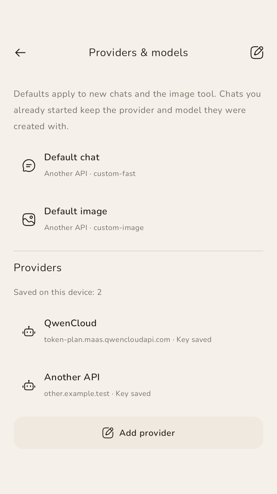

# Blink Chat 0.2.0: multiple providers

The standalone Android app now saves named providers with independent API keys,
HTTPS endpoints and chat/image model lists. Profile → Providers & models shows
the saved accounts and separate default chat/image model controls. The chat
picker combines their models and identifies each provider, even when different
services use the same model ID.

Changing defaults affects new chats. Existing chats retain both their text and
image provider/model choices. Image tools can use a different provider from
text generation. Provider removal deletes only that provider's credential;
its conversations remain and require an explicit replacement model choice.

The original single-provider configuration migrates automatically. Its key is
re-encrypted with provider-specific authenticated data, and the matching
configuration/key changes commit together. A failed commit restores the old
pair. Unreadable legacy ciphertext is retained while allowing a replacement
key to be entered; it never becomes another provider's credential.

## Validation

Verified on 2026-11-12 with JDK 17 and an Android 15 emulator:

- 41 JVM tests pass, including provider/model identity, default validation and
  old conversation decoding.
- 23 Android tests pass; the opt-in live API test is skipped in the regular run.
- Native controller/storage tests cover legacy migration, rollback, separate
  keys and tampered ciphertext, duplicate model IDs, cross-provider image tools,
  persisted defaults, discovery isolation and provider deletion.
- The actual settings UI adds a provider, saves its key and model list, and
  selects independent chat/image defaults. Further regressions cover editing
  during discovery and shell/system back handling for unsaved provider details.
- Debug APK build and Android lint pass. Existing framework/version/style
  warnings remain nonfatal.
- The full host regression suite has 2,155 passing tests, 6 skipped tests and
  489 passing subtests. Its sole failure remains the unrelated live Regolo ASR
  test returning HTTP 402 Payment Required. No host files changed in this work.

Qwen Code `qwen4-max-preview` provided scoped storage and UI implementation.
An independent reviewer found discovery/edit and back-navigation issues;
both were fixed, reviewed again and covered by native UI regressions. The
requested Fable reviewer was unavailable. The opt-in external API test is
skipped in the regular test run; multiple-provider routing was verified with
distinct test origins/keys rather than new external credentials.

## Install

Package: `me.waveio.blinkchat`, version `0.2.0`, version code `2`.
It updates Blink Chat alongside the original paired Blink app.

Build from `mobile-app`:

```sh
./gradlew :standaloneApp:assembleDebug
```

APK: `mobile-app/standaloneApp/build/outputs/apk/debug/standaloneApp-debug.apk`

SHA-256:
`f42881e6de4c97ac1eb5976724ea6cb0b463ee925e18ef19731d8c221336cfc5`

[Setup instructions](../../mobile-app/standaloneApp/README.md).
Provider protocols and the earlier speech/video/background-work limits remain
as documented for 0.1.0. Physical-device and store-release validation are pending.

## Native UI evidence

The existing Compose/Ktor stack and Blink design system were retained. The
native screen and its controls were inspected using the saved UI validation
workflow. This screenshot uses isolated test providers and contains no real key.


