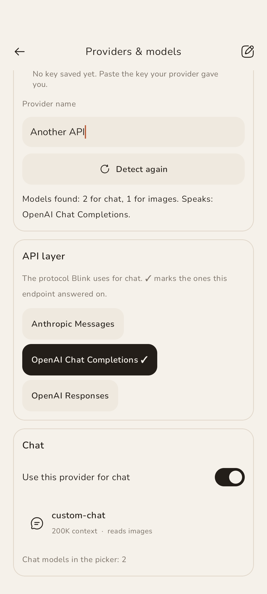
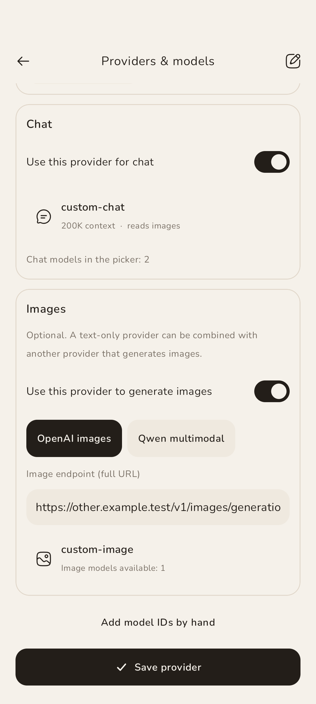
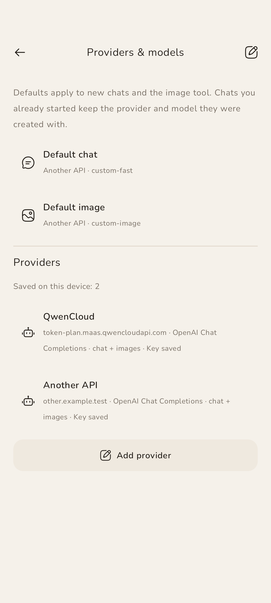

# Blink Chat 0.3.0: endpoint detection, optional images, effort

Provider setup now starts from the endpoint instead of a form of model IDs.
Paste a URL and key and tap **Connect and detect**: Blink Chat finds which API
layers the endpoint serves (Anthropic Messages, OpenAI Chat Completions, OpenAI
Responses), reads the model catalog with context window, output cap, image
input and effort levels, and suggests the image protocol and endpoint when the
endpoint has one.

- Chat speaks all three layers. Anthropic tool rounds replay thinking blocks
  unchanged; Responses uses `store: false`.
- Chat and Images are separate roles per provider. A text-only provider can be
  combined with another provider for images, and the default image model may
  be unset; the image tool is then not offered to the model.
- The chat uses Blink's shared model picker with each model's published effort
  levels, context size and vision flag. Effort is stored per chat and sent only
  after it is chosen explicitly.
- Every model choice in settings uses one searchable list with the same facts.

Saved 0.2.0 providers migrate unchanged; they are treated as Chat Completions.

## Validation

Verified on 2026-11-12 with JDK 17 and an Android 15 (Pixel 8) emulator:

- 52 JVM tests pass, including 11 new protocol tests: Anthropic and Responses
  streaming, tool round trips with native blocks, effort encoding per layer,
  catalog metadata parsing, discovery route probes with the key confined to the
  typed host, and text-only validation.
- 24 Android tests pass; the opt-in live API test is skipped in the regular run.
  The UI test drives Connect against a fixture endpoint, checks the detected
  layer, roles, image endpoint, effort levels and context, and saves.
- A one-off live check against QwenCloud detected Chat Completions and
  Responses, the Qwen image protocol and 21 models (15 chat, 3 image; speech
  models excluded), and returned a real chat reply. QwenCloud publishes no
  context or effort metadata, so none is shown. The temporary key file and
  test were removed; no key is in the repository.
- Debug APK build and Android lint pass.

Not verified against live Anthropic, OpenAI or OpenRouter endpoints: the agents'
vault has no keys for them. Their behaviour is covered by fixtures that follow
the documented formats.

The new JVM protocol tests were drafted by an Antigravity worker and reviewed
and run here; one fixture exposed that compatible gateways may send text in
`content_block_start`, which the parser now accepts.

## Install

Package: `me.waveio.blinkchat`, version `0.3.0`, version code `3`.

```sh
./gradlew :standaloneApp:assembleDebug
```

APK: `mobile-app/standaloneApp/build/outputs/apk/debug/standaloneApp-debug.apk`

SHA-256:
`7463ea5127c5e3abd7c83de2ce5e039e04d760815699ac2173976fddbb1d7d10`

[Setup instructions](../../mobile-app/standaloneApp/README.md).

## Native UI evidence

Captured from the instrumented UI test with fixture providers; no real key.

| Connect and API layer | Chat and image roles | Defaults |
|---|---|---|
|  |  |  |
