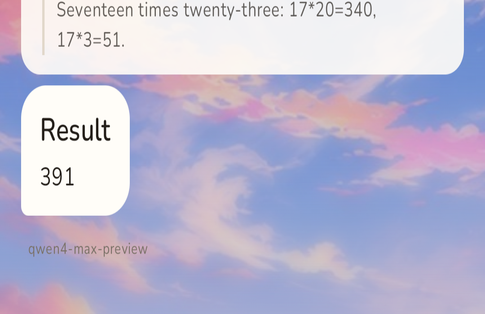

# Blink Chat 0.3.2: reply phase, reasoning, smaller headings

- **Reply phase.** A pending reply says "Sending to the model…" until the
  provider starts its stream, then "Thinking…", and "Working with a tool…"
  during tool calls, so it is clear whether the request is still travelling or
  the model is already working.
- **Reasoning.** Provider reasoning is collected separately from the answer:
  Chat Completions `reasoning_content` (QwenCloud, DeepSeek) or `reasoning`
  (OpenRouter), Anthropic thinking (summaries are requested with
  `thinking: {type: "adaptive", display: "summarized"}` only for models whose
  catalog marks adaptive thinking), and Responses reasoning summary events. It
  shows as a collapsed block above the reply, "Thinking…" while live and
  "Thought for N s" afterwards; tapping opens the text. It is stored with the
  chat, never resent to the model and not part of the copied reply.
- **Headings.** The markdown renderer mapped `#` to Material display styles
  (about 57sp). Chat headings are now 22/20/18/16/15/14sp SemiBold. This is a
  shared fix and also applies to the paired Blink app.

## Validation

Verified on 2026-11-12 with JDK 17 and an Android 15 (Pixel 8) emulator:

- 61 Blink Chat JVM tests pass, including reasoning extraction for all three
  layers, the Anthropic summary request and the adaptive-thinking flag.
- 362 shared-module JVM tests pass; the paired Blink app compiles.
- 26 Blink Chat Android tests pass (the opt-in live test is skipped). A new UI
  test holds the provider response, sees "Sending to the model…", then
  receives streamed reasoning and a `## Result` reply, checks the reasoning
  stays out of the answer, opens the "Thought for N s" block and confirms the
  reasoning is saved with the chat.
- `discoveryFinishingDuringAnEditKeepsBothTheEditAndTheNewModels` timed out
  once in one of two full-suite runs and passed three times on its own and in
  the second full run; it is a timing flake under emulator load, not caused by
  this change, and remains to be stabilized.
- Lint and the debug APK build pass.

Not verified against a live endpoint in this release: the QwenCloud
`reasoning_content` stream format was observed live on 2026-11-12 during the
effort work, and the Anthropic and Responses formats follow fixtures.

## Install

Package `me.waveio.blinkchat`, version `0.3.2`, version code `5`; updates
earlier versions in place.

SHA-256 of `standaloneApp-debug.apk`:
`00d25ffd72de4d1833e3470cc642c0c52ddcf4b4393c6f15aad954d6d089c120`
