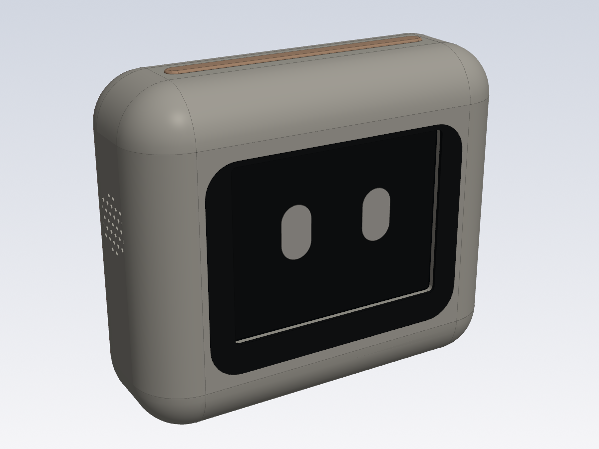
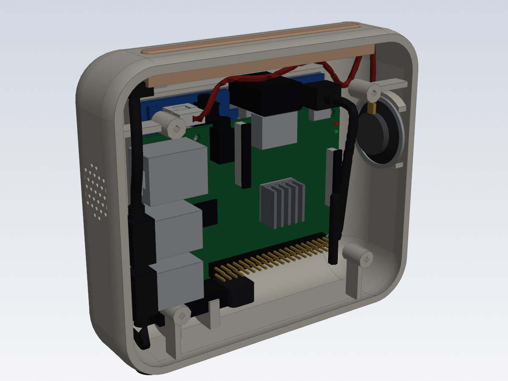
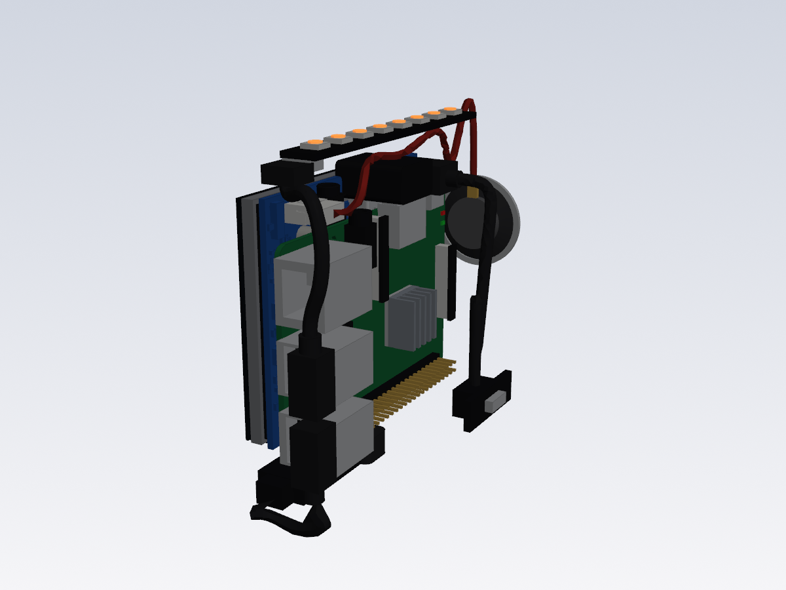

# Claude Bot prototype for SOMA

A real-size 3D model of the phase-1 desk bot, written in CadQuery for the
[SOMA](https://somacad.app/) CAD app. The screen is the face, an LED light bar on top
shows the bot's state, and every internal part is modelled: the Raspberry Pi 3 with all
its ports, the screen from the maker's STEP, the HDMI U-adapter, plugs and cables.

| Outside | Back cover off | Electronics only |
|---|---|---|
|  |  |  |

Outer size 124 × 47 × 110 mm (W × D × H, with feet).

| Path | What |
|---|---|
| `model.py` | Entry point: registers every part with SOMA |
| `parts/params.py` | All dimensions, sources and the user parameters |
| `parts/pi3.py` | Raspberry Pi 3 Model B from the official drawing |
| `parts/screen.py` | Waveshare 3.5inch HDMI LCD (E), split from the maker's STEP |
| `parts/body.py` | Front shell, back cover, light bar diffuser, feet, screws |
| `parts/wiring.py` | LED strip, speaker, microphone, power jack, plugs and cables |
| `NOTES.md` | Parts list, decisions and unverified sizes (read by SOMA's agent) |
| `tools/make-soma.sh` | Packages the model as `dist/claude-bot.soma` |
| `tools/render.py`, `tools/collide.py` | Offscreen render and interference check |

## Open it in SOMA

```sh
hardware/soma-bot/tools/make-soma.sh
```

Then in SOMA: **File → Open** and pick `hardware/soma-bot/dist/claude-bot.soma`. The
script downloads the screen STEP from Waveshare on first use; it is not committed.

## Checks

```sh
SOMA_PY=/Applications/SOMA.app/Contents/Resources/python/bin/python3
"$SOMA_PY" -m soma build --project <unpacked model>
"$SOMA_PY" -I hardware/soma-bot/tools/collide.py <unpacked model>
```

The interference check should only list intended contacts: plugs in their sockets, the
screws in their bosses, the feet on the shell and solids inside the maker's STEP.

This model replaces nothing in `../enclosure/` (the OpenSCAD cardboard version with the
power bank); it is the compact layout with the Pi mounted on the screen.
