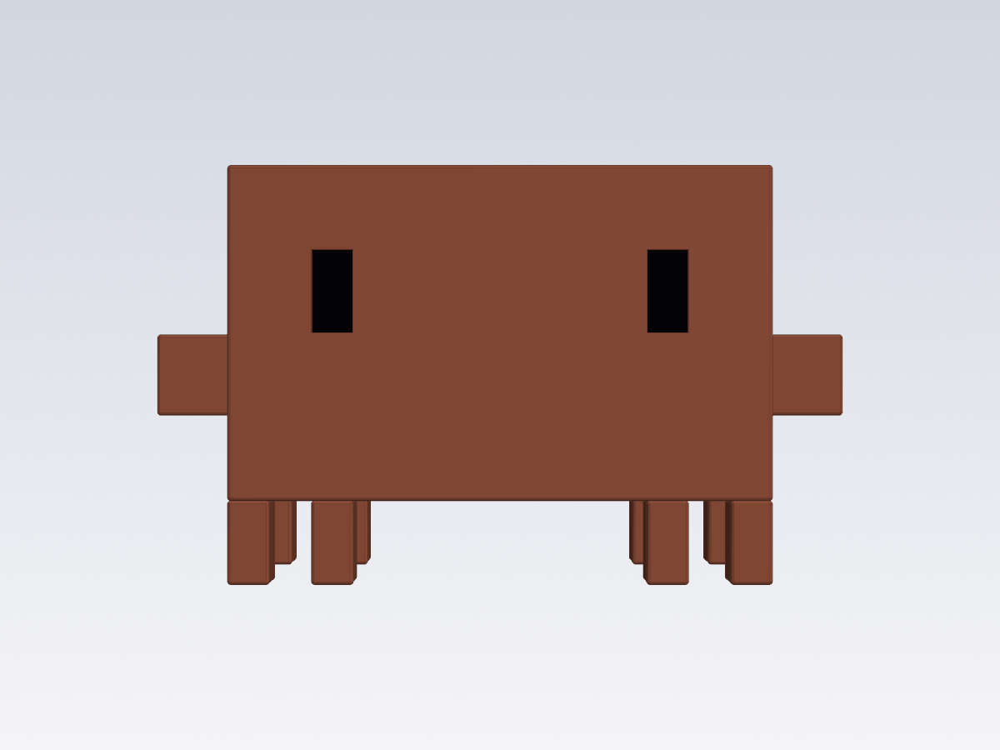
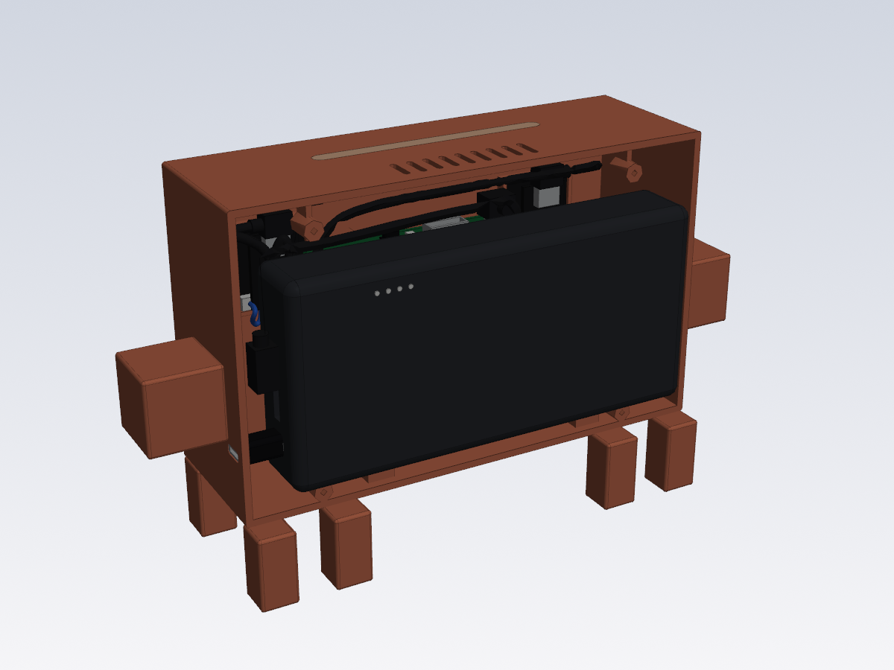

# Claude Bot prototype for SOMA

A real-size 3D model of the phase-1 desk bot built as **Clawd**, the Claude Code mascot,
written in CadQuery for the [SOMA](https://somacad.app/) CAD app. The outside is Clawd pixel
for pixel (taken from the sprite in Claude Code); each eye pixel is a 0.96" OLED screen.
Every internal part is modelled: the Raspberry Pi 3 with all its ports, the eye screens with
their USB boards, the sound card and speaker, the 20000 mAh power bank, plugs and cables.

| Front | Outside | Back cover off | Pi behind the battery | Electronics only |
|---|---|---|---|---|
|  |  |  |  |  |

Body 175.5 × 67.5 × 108 mm (13 × 5 × 4 pixels of 13.5 × 27 mm); 229.5 × 69 × 135 mm with
arms, feet and screw heads.

| Path | What |
|---|---|
| `model.py` | Entry point: registers every part with SOMA |
| `parts/params.py` | Clawd's pixel grid, all dimensions, sources and the user parameters |
| `parts/pi3.py` | Raspberry Pi 3 Model B from the official drawing |
| `parts/body.py` | Body (front shell), back cover, arms, feet, light bar diffuser, screws |
| `parts/wiring.py` | Eye screens, LED strip, sound card, speaker, power bank, plugs and cables |
| `NOTES.md` | Parts list, decisions and unverified sizes (read by SOMA's agent) |
| `tools/make-soma.sh` | Packages the model as `dist/claude-bot.soma` |
| `tools/render.py`, `tools/collide.py` | Offscreen render and interference check |

## Open it in SOMA

```sh
hardware/soma-bot/tools/make-soma.sh
```

Then in SOMA: **File → Open** and pick `hardware/soma-bot/dist/claude-bot.soma`.

## Checks

```sh
SOMA_PY=/Applications/SOMA.app/Contents/Resources/python/bin/python3
"$SOMA_PY" -m soma build --project <unpacked model>
"$SOMA_PY" -I hardware/soma-bot/tools/collide.py <unpacked model>
```

The interference check should only list intended contacts: plugs in their sockets, the
screws in their bosses and the lip of the back cover.

`../enclosure/` is the earlier OpenSCAD cardboard version with the 3.5" screen.
